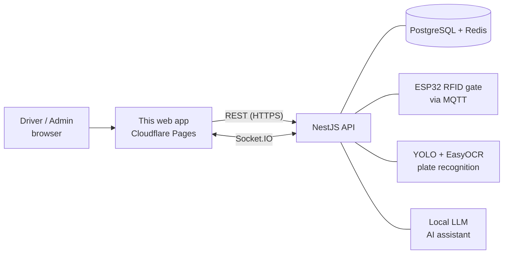

# Smart Parking Platform: Web App

> **A Scalable and Resource-Efficient Smart Parking Platform with a Local LLM-Powered AI Assistant**
> Graduation thesis, B.Sc. Computer Science, VNUK Institute (The University of Da Nang), 2026

**Live demo:** [smart-parking-ui.pages.dev](https://smart-parking-ui.pages.dev) · **Backend repo:** [smart-parking-server](https://github.com/VinhPham131/smart-parking-server)

---

## About the project

Smart Parking automates how a parking facility runs. At the gate, an **ESP32 RFID reader** and a **camera with YOLO + OCR license plate recognition** check every vehicle before the barrier opens. Behind the gate, this web app gives drivers a self-service portal and gives operators a real-time control center. Admins also have an **AI assistant**, running on a local LLM, that answers operational questions and carries out actions from plain-language requests.

This repository contains the **React web application**. The API, IoT integration, OCR service and AI agent are in the [backend repository](https://github.com/VinhPham131/smart-parking-server), which also explains the full architecture.

## Features

### For drivers
- **Book a parking slot** ahead of time in any available area
- **Manage vehicles and RFID cards:** register vehicles and request a gate card
- **Parking history** with check-in and check-out times
- **Payments and wallet:** see fees and payment history
- **Real-time notifications** when a car checks in or out, or when a reservation or card request is approved

### For administrators
- **Live dashboard** of every parking area and slot (available, occupied, reserved, maintenance), updated over WebSockets
- **Management consoles** for users, vehicles, RFID cards, card requests, reservations, payments and parking history, with server-side search, filtering and pagination
- **Parking history with gate snapshots:** the plate image the camera captured at check-in and check-out
- **QR scanner** that processes check-in and check-out from a QR code, as a fallback to RFID
- **AI assistant chat:** ask *"show pending reservations for 08/07/2026"* and approve or reject them directly from the chat results

## Tech stack

| | |
|---|---|
| Framework | **React 19**, **TypeScript**, **Vite 7** |
| Routing | **React Router 7**, with role-based access (`user` / `admin`) decoded from the JWT |
| UI | **Tailwind CSS 4**, Flowbite React, Framer Motion, react-icons |
| Real-time | **Socket.IO client**, with a shared authenticated socket and event hooks |
| QR | qrcode.react, @yudiel/react-qr-scanner |
| Quality | ESLint, Prettier, strict TypeScript |
| Hosting | **Cloudflare Pages** (CI/CD on every push to `main`) |

## How it fits together



## Project structure

```text
src/
├── pages/
│   ├── auth/        Login, register, password reset
│   ├── user/        Driver portal
│   └── admin/       Admin dashboard & management consoles
├── components/      Shared UI: layout, data tables, notifications, AI chat widget
├── services/        API clients & Socket.IO connection
├── hooks/           Socket events, debounce, HTTP error handling
├── types/           Shared TypeScript models
└── utils/           Auth, date/time, currency, HTTP client
```

## Author

**Phạm Quang Vinh**, B.Sc. Computer Science, VNUK Institute for Research and Executive Education, The University of Da Nang
